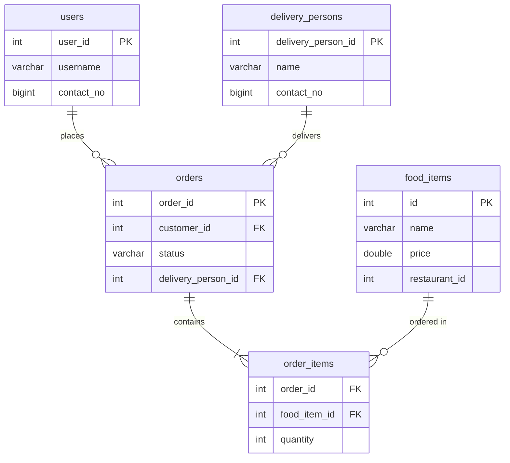

# Food Delivery System

A console-based backend for managing food items, customers, orders, and delivery partners, built with core Java, JDBC, and MySQL.


## Overview

This project models the core flow of a food delivery platform: add food items to a restaurant, register a customer, place an order, and assign a delivery partner. It uses plain JDBC with no frameworks.

**Highlights**

- Interactive console menu with input validation
- All queries use `PreparedStatement` to prevent SQL injection
- Orders and their items are saved in a single transaction (commit or rollback)
- Database credentials are read from environment variables
- Ready-to-run `schema.sql` included

## Features

| Feature | Implemented in |
|---|---|
| Interactive menu with input validation | `Main` |
| Add, remove, and list food items | `FoodServices` |
| Register customers and check if one exists | `CustomerService` |
| Place orders with multiple items (rejects empty carts and invalid quantities) | `OrderService.placeOrder()` |
| Add delivery persons and assign them to orders | `OrderService` |

## Project Structure

```
CASE-STUDY-1/
├── pom.xml
├── schema.sql
├── README.md
└── src/main/java/org/example/
    ├── Main.java              # Console menu (entry point)
    ├── DBConnection.java      # JDBC connection factory
    ├── FoodItem.java          # Model: id, name, price
    ├── FoodServices.java      # Food item operations
    ├── CustomerService.java   # Customer operations
    └── OrderService.java      # Orders and delivery persons
```

## Database Schema

The full schema is in [`schema.sql`](schema.sql).



## Getting Started

### Prerequisites

- JDK 17 or newer
- Maven 3.8 or newer
- MySQL 8.x running on `localhost:3306`

### 1. Clone the repository

```bash
git clone https://github.com/pratikgodase07/CASE-STUDY-1.git
cd CASE-STUDY-1
```

### 2. Create the database

```bash
mysql -u root -p < schema.sql
```

### 3. Configure the connection

Set the following environment variables:

| Variable | Default | Description |
|---|---|---|
| `DB_URL` | `jdbc:mysql://localhost:3306/Food_Delivery_system` | JDBC URL |
| `DB_USER` | `root` | MySQL username |
| `DB_PASSWORD` | *(empty)* | MySQL password |

```bash
# Linux / macOS
export DB_USER=root
export DB_PASSWORD=your_password

# Windows (PowerShell)
$env:DB_USER="root"
$env:DB_PASSWORD="your_password"
```

In IntelliJ IDEA, set these under **Run > Edit Configurations > Environment variables**.

### 4. Build and run

```bash
mvn clean compile
mvn exec:java
```

You can also run `Main.java` directly from your IDE.

## Usage

The console menu wraps the services below:

```
=== Food Delivery System ===

1. Add food item
2. List food items
3. Remove food item
4. Register customer
5. Add delivery person
6. Place order
7. Assign delivery person to order
0. Exit
```

The services can also be called directly from code:

```java
FoodServices foodServices = new FoodServices();
CustomerService customerService = new CustomerService();
OrderService orderService = new OrderService();

// Add food items
foodServices.addFoodItemToRestaurant(101, new FoodItem(1, "Panjabi Thali", 340.0));
foodServices.addFoodItemToRestaurant(101, new FoodItem(2, "Masala Dosa", 120.0));

// Register a customer
customerService.addCustomer(1, "pratik", 9876543210L);

// Place an order (Map<foodItemId, quantity>)
Map<Integer, Integer> cart = new HashMap<>();
cart.put(1, 2);
cart.put(2, 1);
boolean placed = orderService.placeOrder(5001, 1, cart);

// Assign a delivery person
orderService.addDeliveryPerson(10, "Rahul", 9123456780L);
orderService.assignDeliveryPersonToOrder(5001, 10);
```

## API Reference

| Class | Method | Description |
|---|---|---|
| `DBConnection` | `getConnection()` | Returns a MySQL connection using the `DB_*` environment variables |
| `FoodServices` | `addFoodItemToRestaurant(int, FoodItem)` | Adds a food item for a restaurant |
| `FoodServices` | `removeFoodItemFromRestaurant(int, int)` | Removes a restaurant's food item |
| `FoodServices` | `getAllFoodItems()` | Returns all food items |
| `CustomerService` | `addCustomer(int, String, long)` | Registers a customer |
| `CustomerService` | `customerExists(int)` | Checks whether a customer exists |
| `OrderService` | `addDeliveryPerson(int, String, long)` | Adds a delivery person |
| `OrderService` | `placeOrder(int, int, Map<Integer,Integer>)` | Saves an order and its items in one transaction; returns `true` only if committed |
| `OrderService` | `assignDeliveryPersonToOrder(int, int)` | Assigns a delivery person to an order |

## Troubleshooting

| Problem | Likely cause | Fix |
|---|---|---|
| `Access denied for user 'root'` | Wrong or missing credentials | Check `DB_USER` and `DB_PASSWORD` |
| `Unknown database 'Food_Delivery_system'` | Database not created | Run `schema.sql` |
| `Communications link failure` | MySQL is not running | Start the MySQL service |
| `Duplicate entry '1' for key 'PRIMARY'` | ID already exists | Use a new ID or clear the table |
| `Cannot add or update a child row` | Foreign key violation | Create the customer or food item first |
| `release version 17 not supported` | JDK older than 17 | Install JDK 17 or newer |

## Security

Credentials are read from environment variables and are not stored in the code. All SQL uses `PreparedStatement`, and `.env` and `.idea/` are git-ignored.

An earlier commit in this repository's history contained a hardcoded database password. If that password is used anywhere, change it.

## Roadmap

- [x] JDBC connection factory
- [x] Food item add, remove, and list
- [x] Customer registration
- [x] Transactional order placement
- [x] Delivery person assignment
- [x] Interactive console menu
- [x] Environment-based configuration
- [x] `schema.sql`
- [ ] Propagate database errors to callers instead of printing them
- [ ] Order status updates (Pending, Preparing, Out for delivery, Delivered)
- [ ] Restaurants table with foreign key on `food_items`
- [ ] Auto-generated IDs (`AUTO_INCREMENT`)
- [ ] Unit tests (JUnit 5)
- [ ] Spring Boot REST API with React frontend

## Contributing

1. Fork the repository
2. Create a branch: `git checkout -b feature/your-feature`
3. Commit your changes: `git commit -m "Add your feature"`
4. Push the branch: `git push origin feature/your-feature`
5. Open a pull request

## Author

**Pratik Godase**
GitHub: [@pratikgodase07](https://github.com/pratikgodase07)