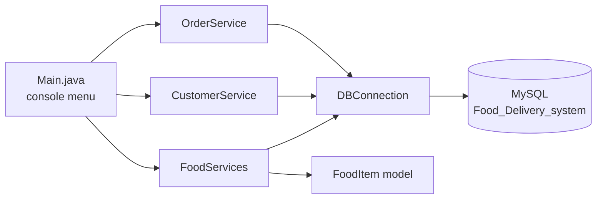
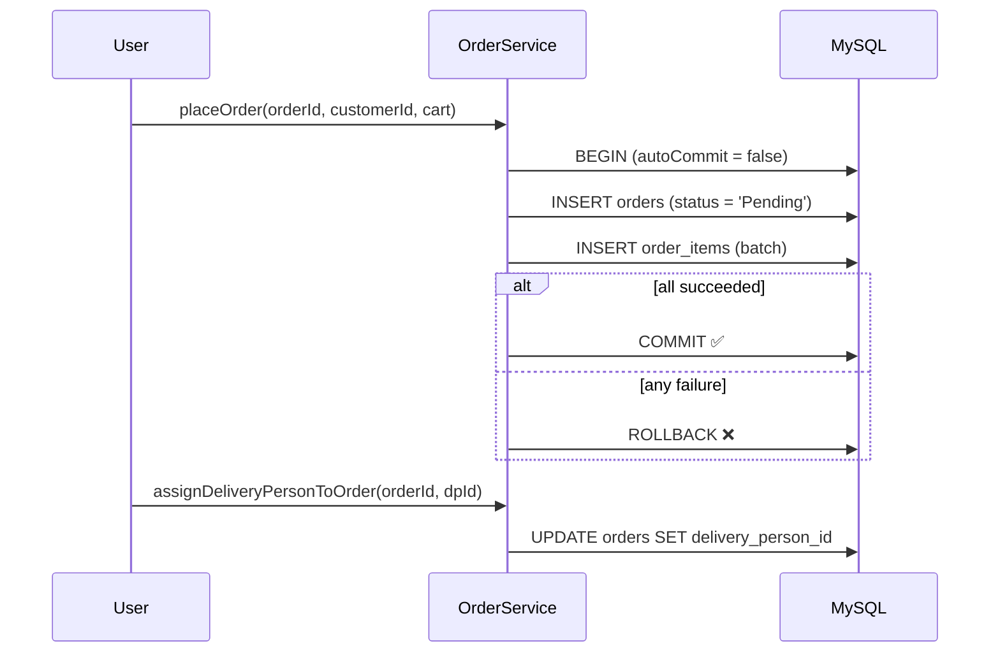
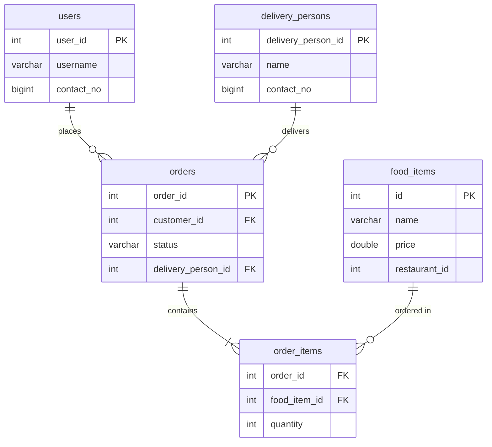

<div align="center">

# 🍔 Food Delivery System - Case Study 1

**A console-based Java + MySQL backend for managing food items, customers, orders, and delivery partners.**


[✨ Features](#-features) • [🏗️ Architecture](#️-architecture) • [🗄️ Database](#️-database-schema) • [🚀 Quick Start](#-quick-start) • [🧪 Usage](#-usage-examples) • [🗺️ Roadmap](#️-roadmap)

</div>

---

## 📖 About

**CASE-STUDY-1** is a Food Delivery System built with **core Java and plain JDBC** (no frameworks). It models the essential flow of a delivery platform:

> 🍽️ add food to a restaurant → 👤 register a customer → 🛒 place an order → 🛵 assign a delivery partner

- 🖥️ **Interactive console menu**: drive the whole flow from the terminal, no code editing needed.
- 🛡️ **Safe SQL**: every query uses `PreparedStatement` (protection against SQL injection).
- 🔁 **Transactional orders**: an order and its items are saved together or not at all (commit / rollback).
- 🔐 **No credentials in code**: database settings are read from environment variables.
- 🗄️ **Ready-to-run schema**: `schema.sql` is included.

---

## ✨ Features

| | Feature | Where |
|---|---|---|
| 🖥️ | Interactive menu with input validation (re-prompts on bad input) | `Main` |
| 🍕 | Add / remove food items for a restaurant | `FoodServices` |
| 📋 | List all food items | `FoodServices.getAllFoodItems()` |
| 👤 | Register a customer & check if one exists | `CustomerService` |
| 🛒 | Place an order with multiple items (transactional, rejects empty carts / invalid quantities) | `OrderService.placeOrder()` |
| 🛵 | Add delivery persons & assign them to orders | `OrderService` |

---

## 🏗️ Architecture



<details>
<summary><b>📁 Project structure (click to expand)</b></summary>

```
CASE-STUDY-1/
├── pom.xml                              # Maven config (Java 17+, MySQL connector, exec plugin)
├── schema.sql                           # Database + tables
├── README.md
└── src/main/java/org/example/
    ├── Main.java              # Entry point: interactive console menu
    ├── DBConnection.java      # JDBC connection factory (reads DB_* env vars)
    ├── FoodItem.java          # Model (id, name, price)
    ├── FoodServices.java      # Food item CRUD
    ├── CustomerService.java   # Customer create / exists
    └── OrderService.java      # Orders + delivery persons
```

</details>

<details>
<summary><b>🧩 Class reference (click to expand)</b></summary>

| Class | Method | What it does |
|---|---|---|
| `DBConnection` | `getConnection()` | Returns a new MySQL `Connection` using `DB_URL`, `DB_USER`, `DB_PASSWORD` |
| `FoodItem` | getters / setters / `toString()` | POJO for a menu item |
| `FoodServices` | `addFoodItemToRestaurant(int restaurantId, FoodItem item)` | Inserts into `food_items` |
| `FoodServices` | `removeFoodItemFromRestaurant(int restaurantId, int foodItemId)` | Deletes a restaurant's item, reports if not found |
| `FoodServices` | `getAllFoodItems()` | Returns `List<FoodItem>` |
| `CustomerService` | `addCustomer(int userId, String username, long contactNo)` | Inserts into `users` |
| `CustomerService` | `customerExists(int userId)` | `true` if the user is found |
| `OrderService` | `addDeliveryPerson(int id, String name, long contactNo)` | Inserts into `delivery_persons` |
| `OrderService` | `placeOrder(int orderId, int customerId, Map<Integer,Integer> cart)` | Saves order + items in **one transaction** (commit / rollback). Returns `true` only if committed |
| `OrderService` | `assignDeliveryPersonToOrder(int orderId, int deliveryPersonId)` | Updates the order's delivery person |

</details>

### 🔄 Order flow



---

## 🗄️ Database schema

The full schema ships in [`schema.sql`](schema.sql). The diagram below shows how the tables relate.



---

## 🚀 Quick start

### ✅ Prerequisites

- [ ] **JDK 17 or newer** (`java -version`)
- [ ] **Maven 3.8+** (`mvn -v`)
- [ ] **MySQL 8.x** running on `localhost:3306`

### 1️⃣ Clone

```bash
git clone https://github.com/pratikgodase07/CASE-STUDY-1.git
cd CASE-STUDY-1
```

### 2️⃣ Create the database

Run [`schema.sql`](schema.sql) from the CLI (or paste it into MySQL Workbench):

```bash
mysql -u root -p < schema.sql
```

### 3️⃣ Configure the connection

Credentials are read from environment variables, so nothing sensitive is stored in the code:

| Variable | Default | Purpose |
|---|---|---|
| `DB_URL` | `jdbc:mysql://localhost:3306/Food_Delivery_system` | JDBC URL |
| `DB_USER` | `root` | MySQL username |
| `DB_PASSWORD` | *(empty)* | MySQL password |

```bash
# Linux / macOS
export DB_USER=root
export DB_PASSWORD=your_password

# Windows (PowerShell)
$env:DB_USER="root"
$env:DB_PASSWORD="your_password"
```

> In IntelliJ IDEA, set these under **Run → Edit Configurations → Environment variables**.

### 4️⃣ Build & run

```bash
mvn clean compile
mvn exec:java
```

Or open the project in **IntelliJ IDEA** and run `Main.java` directly.

<details>
<summary><b>✅ Expected output</b></summary>

```
=== Food Delivery System ===

1. Add food item
2. List food items
3. Remove food item
4. Register customer
5. Add delivery person
6. Place order
7. Assign delivery person to order
0. Exit
Choose an option: 1
Restaurant ID: 101
Food item ID: 1
Name: Panjabi Thali
Price: 340
Food item saved to database!
```

</details>

<details>
<summary><b>🛠️ Troubleshooting</b></summary>

| Problem | Likely cause | Fix |
|---|---|---|
| `Access denied for user 'root'` | Wrong or missing `DB_USER` / `DB_PASSWORD` | Set the environment variables (see step 3) |
| `Unknown database 'Food_Delivery_system'` | Database not created | Run `schema.sql` |
| `Communications link failure` | MySQL is not running | Start the MySQL service |
| `Duplicate entry '1' for key 'PRIMARY'` | IDs are passed manually and already exist | Use a new ID or clear the table |
| `Cannot add or update a child row` | Foreign key violation (e.g. unknown customer or food item in an order) | Create the customer / food item first; a failed order is rolled back automatically |
| `release version 17 not supported` | JDK older than 17 | Install JDK 17 or newer |

</details>

---

## 🧪 Usage examples

The menu in `Main` wraps the services below. You can also call them directly from your own code:

<details open>
<summary><b>🍕 Add and list food items</b></summary>

```java
FoodServices foodServices = new FoodServices();

foodServices.addFoodItemToRestaurant(101, new FoodItem(1, "Panjabi Thali", 340.0));
foodServices.addFoodItemToRestaurant(101, new FoodItem(2, "Masala Dosa", 120.0));

System.out.println(foodServices.getAllFoodItems());
```

</details>

<details>
<summary><b>👤 Register a customer</b></summary>

```java
CustomerService customerService = new CustomerService();

customerService.addCustomer(1, "pratik", 9876543210L);
System.out.println(customerService.customerExists(1)); // true
```

</details>

<details>
<summary><b>🛒 Place an order (transactional)</b></summary>

```java
OrderService orderService = new OrderService();

// Map<foodItemId, quantity>
Map<Integer, Integer> cart = new HashMap<>();
cart.put(1, 2);   // 2 x Panjabi Thali
cart.put(2, 1);   // 1 x Masala Dosa

boolean ok = orderService.placeOrder(5001, 1, cart); // true only if committed
```

</details>

<details>
<summary><b>🛵 Assign a delivery person</b></summary>

```java
orderService.addDeliveryPerson(10, "Rahul", 9123456780L);
orderService.assignDeliveryPersonToOrder(5001, 10);
```

</details>

<details>
<summary><b>🗑️ Remove a food item</b></summary>

```java
foodServices.removeFoodItemFromRestaurant(101, 2);
```

</details>

---

## 🔐 Security note

Database credentials are read from environment variables (see [Quick start](#-quick-start)) and are no longer hardcoded.

> ⚠️ An earlier commit in this repository's history contained a hardcoded database password. Git history is permanent, so if that password is used anywhere real, **change it**. Never reuse a password that was ever committed.

Also in place: all SQL uses `PreparedStatement`, `.env` and `.idea/` are git-ignored.

---

## 🗺️ Roadmap

- [x] JDBC connection factory
- [x] Food item add / remove / list
- [x] Customer registration
- [x] Transactional order placement
- [x] Delivery person assignment
- [x] Interactive console menu (`Scanner`) in `Main`
- [x] Move credentials to environment variables
- [x] Add `schema.sql` to the repo
- [ ] Surface database errors to callers instead of printing them (services currently catch `SQLException` internally)
- [ ] Order status updates (`Pending → Preparing → Out for delivery → Delivered`)
- [ ] Restaurants table + foreign key on `food_items`
- [ ] Auto-generated IDs (`AUTO_INCREMENT`) instead of manual IDs
- [ ] Unit tests (JUnit 5)
- [ ] Migrate to Spring Boot REST API + React frontend

> 💡 Ideas welcome. Open an issue and pick something from the list.

---

## 🤝 Contributing

1. 🍴 Fork the repo
2. 🌿 Create a branch: `git checkout -b feature/amazing-feature`
3. 💾 Commit: `git commit -m "Add amazing feature"`
4. 📤 Push: `git push origin feature/amazing-feature`
5. 🔃 Open a Pull Request

---

## 👨‍💻 Author

**Pratik Godase**
GitHub: [@pratikgodase07](https://github.com/pratikgodase07)

<div align="center">

⭐ If this project helped you, consider giving it a star!

</div>
