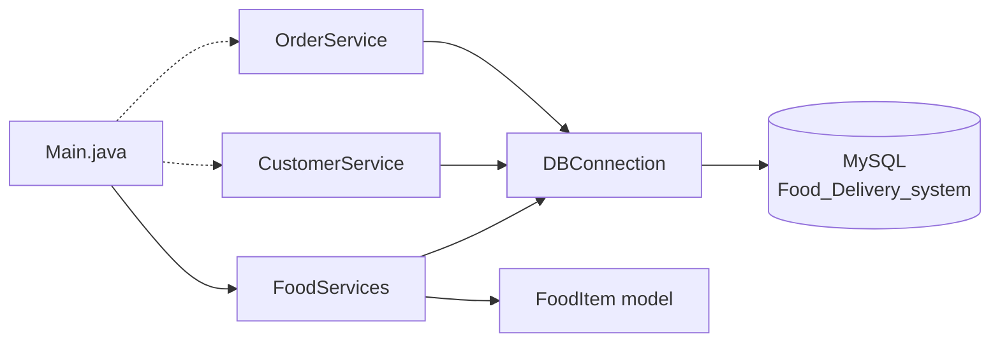
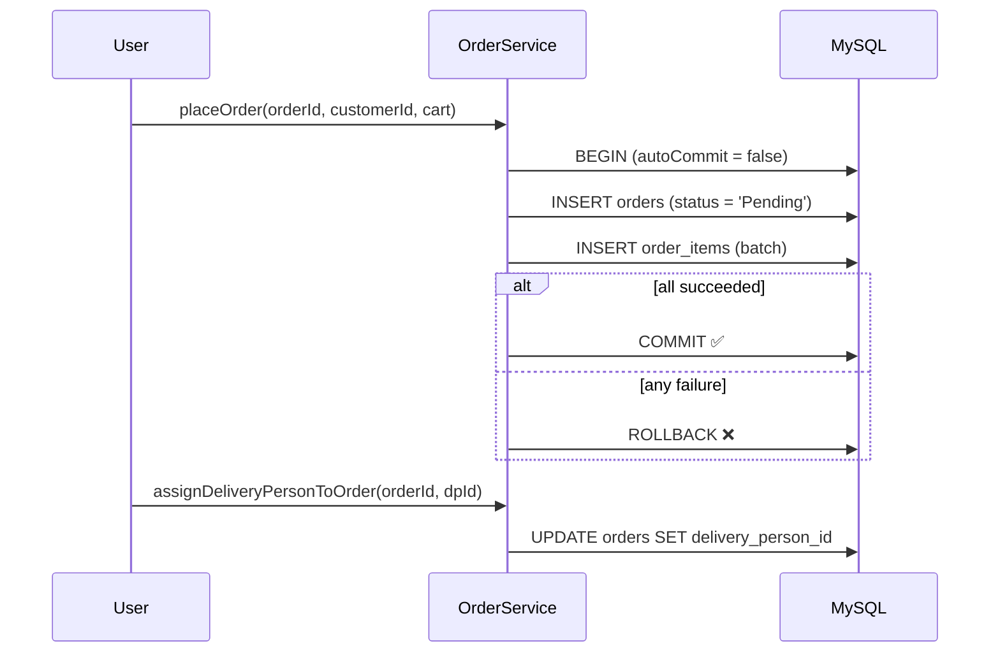
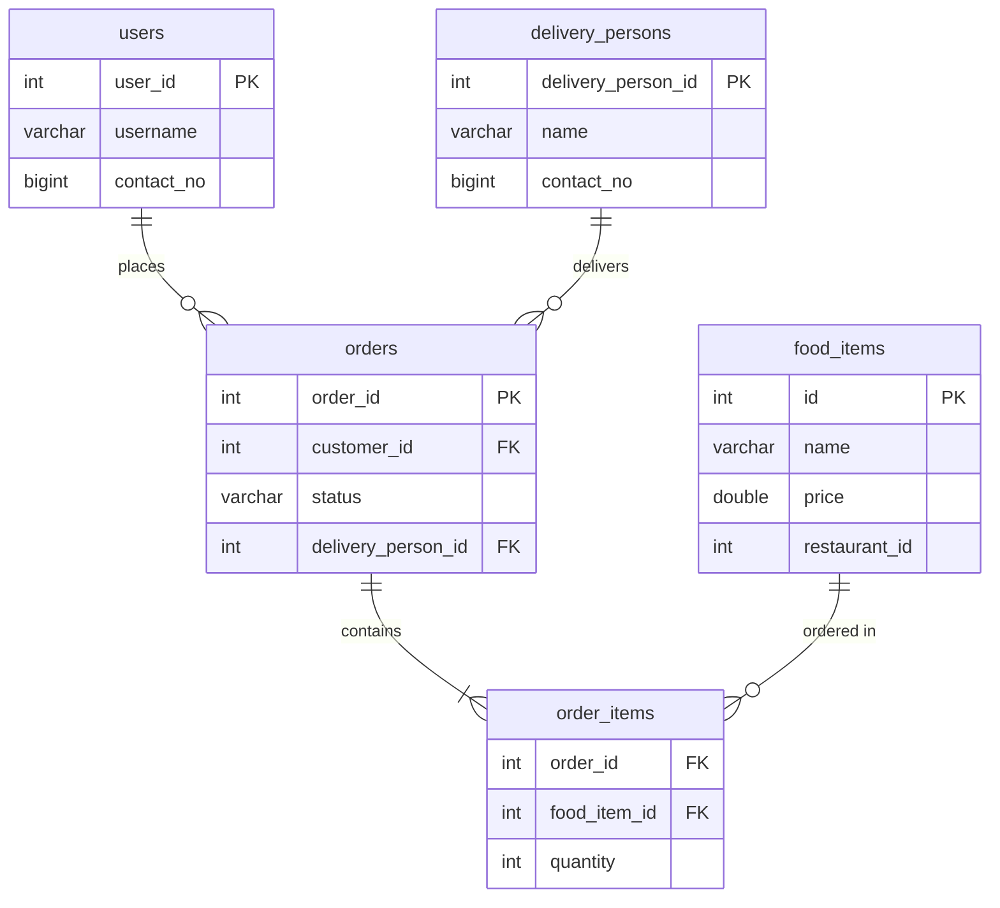

<div align="center">

# 🍔 Food Delivery System

**A console-based Java + MySQL backend for managing food items, customers, orders, and delivery partners.**


[✨ Features](#-features) • [🏗️ Architecture](#️-architecture) • [🗄️ Database](#️-database-schema) • [🚀 Quick Start](#-quick-start) • [🧪 Usage](#-usage-examples) • [🗺️ Roadmap](#️-roadmap)

</div>

---

## 📖 About

**CASE-STUDY-1** is a Food Delivery System built with **core Java and plain JDBC** (no frameworks). It models the essential flow of a delivery platform:

> 🍽️ add food to a restaurant → 👤 register a customer → 🛒 place an order → 🛵 assign a delivery partner

Every database operation uses `PreparedStatement` (protection against SQL injection), and order placement runs inside a **transaction** so an order and its items are saved together or not at all.

---

## ✨ Features

| | Feature | Where |
|---|---|---|
| 🍕 | Add / remove food items for a restaurant | `FoodServices` |
| 📋 | List all food items | `FoodServices.getAllFoodItems()` |
| 👤 | Register a customer & check if one exists | `CustomerService` |
| 🛒 | Place an order with multiple items (transactional) | `OrderService.placeOrder()` |
| 🛵 | Add delivery persons & assign them to orders | `OrderService` |

---

## 🏗️ Architecture



*Solid arrows = used in the current `Main`. Dotted arrows = available services you can call.*

<details>
<summary><b>📁 Project structure (click to expand)</b></summary>

```
CASE-STUDY-1/
├── pom.xml                              # Maven config (Java 22, MySQL connector)
├── README.md
└── src/main/java/org/example/
    ├── Main.java              # Entry point / demo
    ├── DBConnection.java      # JDBC connection factory
    ├── FoodItem.java          # Model (id, name, price)
    ├── FoodServices.java      # Food item CRUD
    ├── CustomerService.java   # Customer create / exists
    └── OrderService.java      # Orders + delivery persons
```

</details>

<details>
<summary><b>🧩 Class reference (click to expand)</b></summary>

| Class | Method | What it does |
|---|---|---|
| `DBConnection` | `getConnection()` | Returns a new MySQL `Connection` |
| `FoodItem` | getters / setters / `toString()` | POJO for a menu item |
| `FoodServices` | `addFoodItemToRestaurant(int restaurantId, FoodItem item)` | Inserts into `food_items` |
| `FoodServices` | `removeFoodItemFromRestaurant(int restaurantId, int foodItemId)` | Deletes a restaurant's item, reports if not found |
| `FoodServices` | `getAllFoodItems()` | Returns `List<FoodItem>` |
| `CustomerService` | `addCustomer(int userId, String username, long contactNo)` | Inserts into `users` |
| `CustomerService` | `customerExists(int userId)` | `true` if the user is found |
| `OrderService` | `addDeliveryPerson(int id, String name, long contactNo)` | Inserts into `delivery_persons` |
| `OrderService` | `placeOrder(int orderId, int customerId, Map<Integer,Integer> cart)` | Saves order + items in **one transaction** (commit / rollback) |
| `OrderService` | `assignDeliveryPersonToOrder(int orderId, int deliveryPersonId)` | Updates the order's delivery person |

</details>

### 🔄 Order flow



---

## 🗄️ Database schema

The repo does not ship a SQL script, so this schema is **derived from the queries in the code**. Adjust the types and constraints as needed.



<details>
<summary><b>📜 Copy-paste setup SQL (click to expand)</b></summary>

```sql
CREATE DATABASE IF NOT EXISTS Food_Delivery_system;
USE Food_Delivery_system;

CREATE TABLE users (
    user_id     INT PRIMARY KEY,
    username    VARCHAR(100) NOT NULL,
    contact_no  BIGINT
);

CREATE TABLE food_items (
    id             INT PRIMARY KEY,
    name           VARCHAR(100) NOT NULL,
    price          DOUBLE NOT NULL,
    restaurant_id  INT NOT NULL
);

CREATE TABLE delivery_persons (
    delivery_person_id  INT PRIMARY KEY,
    name                VARCHAR(100) NOT NULL,
    contact_no          BIGINT
);

CREATE TABLE orders (
    order_id            INT PRIMARY KEY,
    customer_id         INT NOT NULL,
    status              VARCHAR(30) DEFAULT 'Pending',
    delivery_person_id  INT NULL,
    FOREIGN KEY (customer_id)        REFERENCES users(user_id),
    FOREIGN KEY (delivery_person_id) REFERENCES delivery_persons(delivery_person_id)
);

CREATE TABLE order_items (
    order_id      INT NOT NULL,
    food_item_id  INT NOT NULL,
    quantity      INT NOT NULL,
    PRIMARY KEY (order_id, food_item_id),
    FOREIGN KEY (order_id)     REFERENCES orders(order_id),
    FOREIGN KEY (food_item_id) REFERENCES food_items(id)
);
```

</details>

---

## 🚀 Quick start

### ✅ Prerequisites

- [ ] **JDK 22** (`java -version`)
- [ ] **Maven 3.8+** (`mvn -v`)
- [ ] **MySQL 8.x** running on `localhost:3306`

### 1️⃣ Clone

```bash
git clone https://github.com/pratikgodase07/CASE-STUDY-1.git
cd CASE-STUDY-1
```

### 2️⃣ Create the database

Run the setup SQL above in MySQL Workbench or the CLI:

```bash
mysql -u root -p < schema.sql
```

### 3️⃣ Configure the connection

Open `src/main/java/org/example/DBConnection.java` and set your own MySQL username and password.

> ⚠️ **Never commit real passwords.** See the [security note](#-security-note) below for the safer environment-variable approach.

### 4️⃣ Build & run

```bash
mvn clean compile
mvn exec:java -Dexec.mainClass="org.example.Main"
```

Or open the project in **IntelliJ IDEA** and run `Main.java` directly.

<details>
<summary><b>✅ Expected output</b></summary>

```
Food item saved to database!
Food items in DB: [FoodItem{id=1, name='Panjabi Thali', price=340.0}]
```

</details>

<details>
<summary><b>🛠️ Troubleshooting</b></summary>

| Problem | Likely cause | Fix |
|---|---|---|
| `Access denied for user 'root'` | Wrong credentials in `DBConnection` | Update the username / password |
| `Unknown database 'Food_Delivery_system'` | Database not created | Run the setup SQL |
| `Communications link failure` | MySQL is not running | Start the MySQL service |
| `Duplicate entry '1' for key 'PRIMARY'` | IDs are passed manually and already exist | Use a new ID or clear the table |
| `release version 22 not supported` | Older JDK | Install JDK 22 or lower `maven.compiler.*` in `pom.xml` |

</details>

---

## 🧪 Usage examples

<details open>
<summary><b>🍕 Add and list food items</b></summary>

```java
FoodServices foodServices = new FoodServices();

foodServices.addFoodItemToRestaurant(101, new FoodItem(1, "Panjabi Thali", 340.0));
foodServices.addFoodItemToRestaurant(101, new FoodItem(2, "Masala Dosa", 120.0));

System.out.println(foodServices.getAllFoodItems());
```

</details>

<details>
<summary><b>👤 Register a customer</b></summary>

```java
CustomerService customerService = new CustomerService();

customerService.addCustomer(1, "pratik", 9876543210L);
System.out.println(customerService.customerExists(1)); // true
```

</details>

<details>
<summary><b>🛒 Place an order (transactional)</b></summary>

```java
OrderService orderService = new OrderService();

// Map<foodItemId, quantity>
Map<Integer, Integer> cart = new HashMap<>();
cart.put(1, 2);   // 2 x Panjabi Thali
cart.put(2, 1);   // 1 x Masala Dosa

orderService.placeOrder(5001, 1, cart);
```

</details>

<details>
<summary><b>🛵 Assign a delivery person</b></summary>

```java
orderService.addDeliveryPerson(10, "Rahul", 9123456780L);
orderService.assignDeliveryPersonToOrder(5001, 10);
```

</details>

<details>
<summary><b>🗑️ Remove a food item</b></summary>

```java
foodServices.removeFoodItemFromRestaurant(101, 2);
```

</details>

---

## 🔐 Security note

<details>
<summary><b>Use environment variables instead of hardcoded credentials (recommended)</b></summary>

Credentials should not live in source control. If a password was ever committed, **change it** and treat the old one as exposed, since it remains in git history.

Replace the constants in `DBConnection.java`:

```java
public class DBConnection {
    private static final String URL =
            System.getenv().getOrDefault("DB_URL", "jdbc:mysql://localhost:3306/Food_Delivery_system");
    private static final String USER     = System.getenv("DB_USER");
    private static final String PASSWORD = System.getenv("DB_PASSWORD");

    public static Connection getConnection() throws SQLException {
        return DriverManager.getConnection(URL, USER, PASSWORD);
    }
}
```

Then run with:

```bash
# Linux / macOS
export DB_USER=root
export DB_PASSWORD=your_password

# Windows (PowerShell)
$env:DB_USER="root"
$env:DB_PASSWORD="your_password"
```

</details>

---

## 🗺️ Roadmap

- [x] JDBC connection factory
- [x] Food item add / remove / list
- [x] Customer registration
- [x] Transactional order placement
- [x] Delivery person assignment
- [ ] Interactive console menu (`Scanner`) in `Main`
- [ ] Move credentials to environment variables / `.properties`
- [ ] Add `schema.sql` to the repo
- [ ] Order status updates (`Pending → Preparing → Out for delivery → Delivered`)
- [ ] Restaurants table + foreign key on `food_items`
- [ ] Auto-generated IDs (`AUTO_INCREMENT`) instead of manual IDs
- [ ] Unit tests (JUnit 5)
- [ ] Migrate to Spring Boot REST API + React frontend

> 💡 Ideas welcome. Open an issue and pick something from the list.

---

## 🤝 Contributing

1. 🍴 Fork the repo
2. 🌿 Create a branch: `git checkout -b feature/amazing-feature`
3. 💾 Commit: `git commit -m "Add amazing feature"`
4. 📤 Push: `git push origin feature/amazing-feature`
5. 🔃 Open a Pull Request

---

## 👨‍💻 Author

**Pratik Godase**
GitHub: [@pratikgodase07](https://github.com/pratikgodase07)

<div align="center">

⭐ If this project helped you, consider giving it a star!

</div>